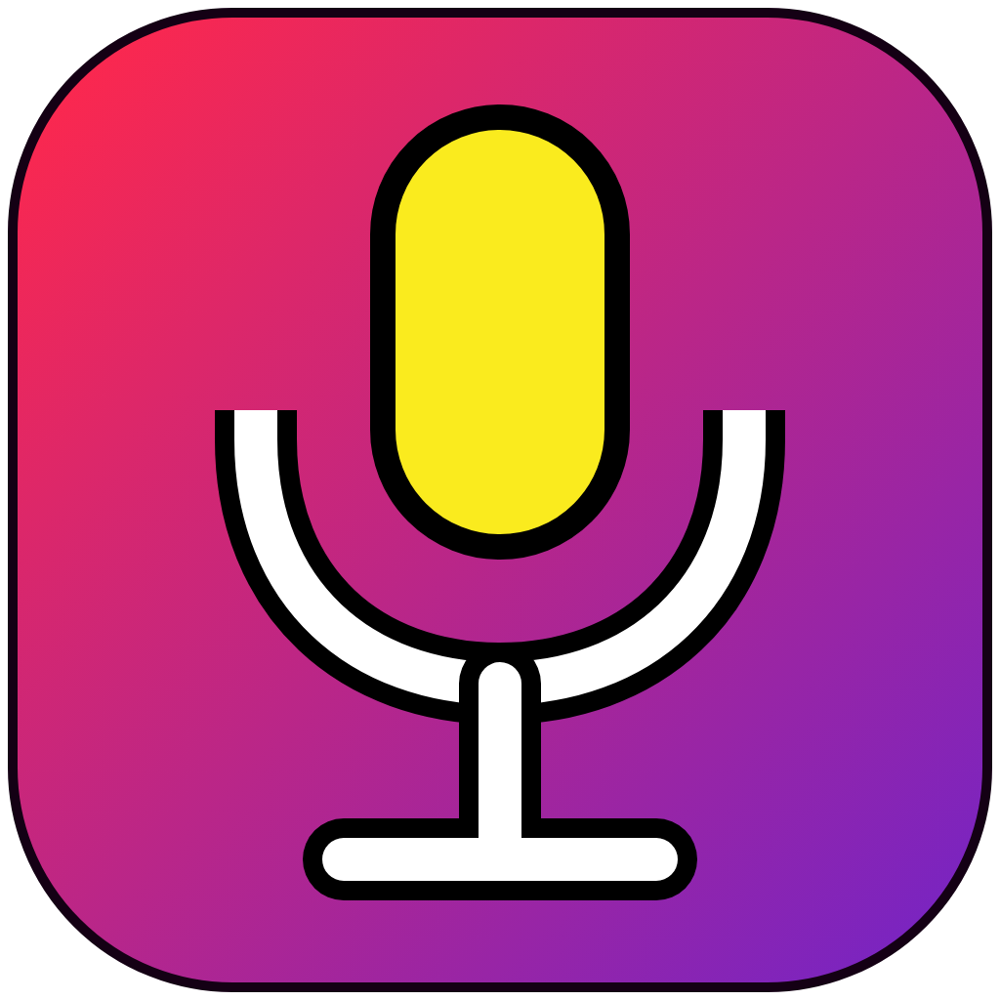
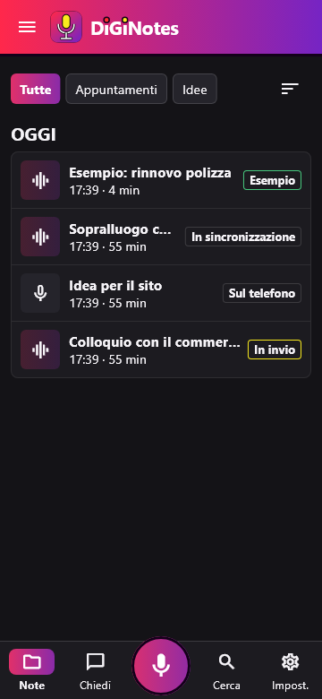
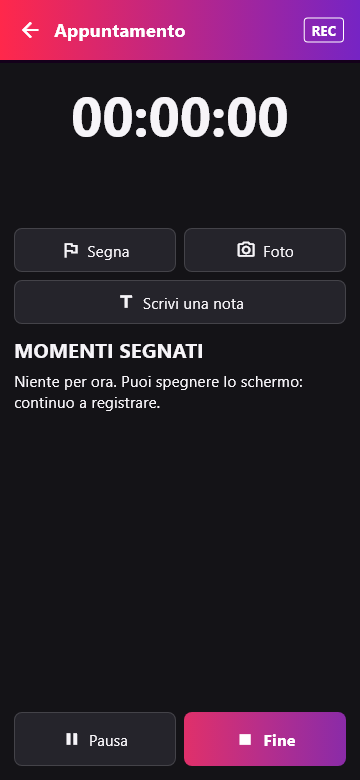
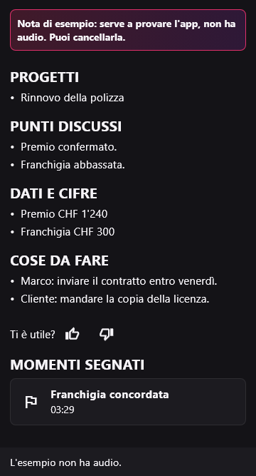
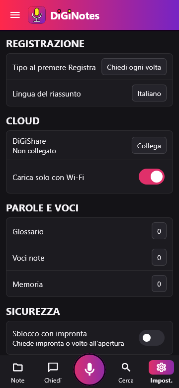

<p align="center">
  
</p>

<p align="center">
  
</p>

# DiGiNotes

## 🎙️ Registra appuntamenti e idee con il telefono Android

### ⬇️ [Scarica DiGiNotes](https://github.com/DiGi-Apps-Dev/DiGiNotes/releases/latest)

L'audio resta sul tuo telefono. Se vuoi anche la trascrizione e il riassunto, colleghi il tuo server [DiGiShare](https://github.com/DiGi-Apps-Dev/DiGiShare). DiGiNotes fa parte di **DiGi Apps**, app gratuite.

### Cosa fa

Senza server:

- **Registra** un appuntamento o una nota vocale, anche a schermo spento, con pausa e ripresa.
- **Riascolta** subito dopo la registrazione, scrivi il titolo e decidi se tenerla o eliminarla.
- **Se l'app si chiude** a metà registrazione, alla riapertura ritrovi l'audio.
- **Taglia, unisci, sposta in cartelle** e tieni le note nel cestino finché vuoi.
- **Foto e segni** nei momenti che contano, durante la registrazione.
- **Condividi audio:** il file va a Drive, all'email, al PC o dove vuoi, con la condivisione di Android.

Con un server DiGiShare:

- **Trascrizione** parola per parola con chi parla.
- **Riassunto ordinato:** progetti, punti discussi, cose da fare, cose fatte, in sospeso.
- **Domande alle tue note** e link da mandare a chi vuoi.

## Come si vede

| | |
|---|---|
|  |  |

| | |
|---|---|
|  |  |

## Installazione

DiGiNotes non è sul Play Store: si installa dal file APK.

1. Dalla pagina **Releases** scarica `DiGiNotes-<versione>.apk` sul telefono.
2. Aprilo. Android chiede di permettere l'installazione dall'app con cui l'hai aperto, di solito Chrome o Archivio: permettila.
3. Se compare Play Protect, scegli di installare comunque: l'app non viene dal Play Store e Google non la conosce.

Al primo avvio DiGiNotes chiede il microfono e le notifiche. Le notifiche servono ad Android per lasciar registrare l'app a schermo spento.

## Collegare il tuo server

Serve solo per trascrizione e riassunto. Se non hai un server, salta questo punto: l'app funziona lo stesso.

1. Installa DiGiShare seguendo il suo [README](https://github.com/DiGi-Apps-Dev/DiGiShare).
2. In DiGiNotes apri **Impostazioni › Cloud › DiGiShare**.
3. Scrivi l'indirizzo del tuo server, che deve iniziare con `https://`, poi nome utente, password e codice dell'Authenticator.

La password non resta sul telefono. Ogni nota parte verso il server solo quando premi **Invia**.

## Requisiti

- Android 10 o più recente.
- Per trascrizione e riassunto, un server DiGiShare tuo.

## Compilare il codice

Serve Flutter 3.35.

```bash
flutter pub get
flutter test
flutter build apk --release
```

Se manca `android/key.properties`, l'APK si firma con la chiave di debug. Non mettere mai la tua chiave di firma nel repository.

## Disinstallare

Impostazioni di Android › App › DiGiNotes › Disinstalla. Le note e gli audio sul telefono si cancellano insieme all'app: prima condividi quello che vuoi tenere.

## Licenza

DiGiNotes è gratuito, con licenza **MIT** (vedi [LICENSE](LICENSE)). Usa componenti di terze parti con le loro licenze, elencati in `pubspec.yaml`.
